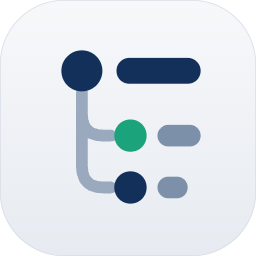
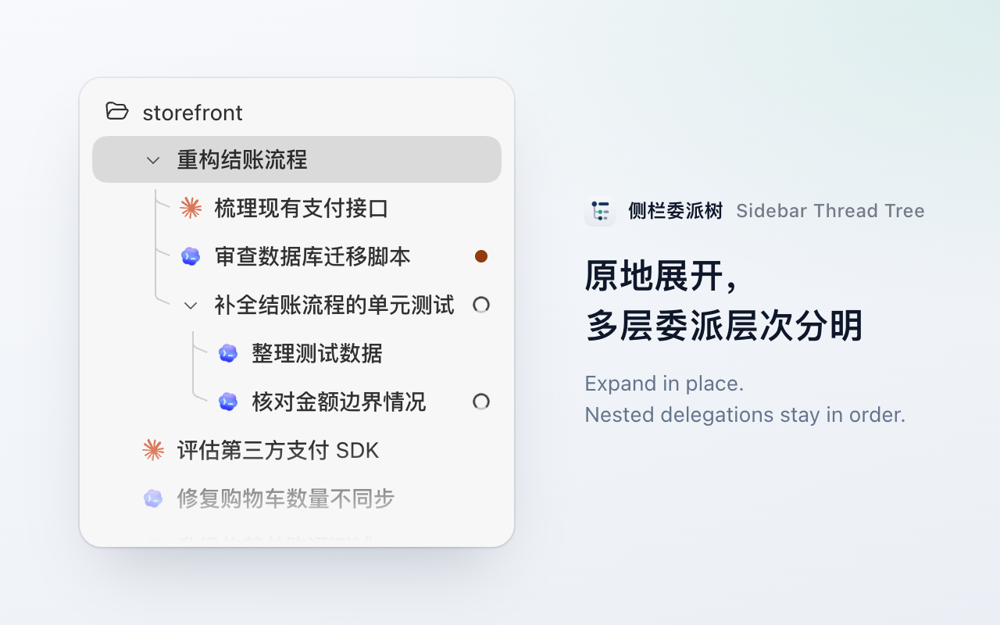
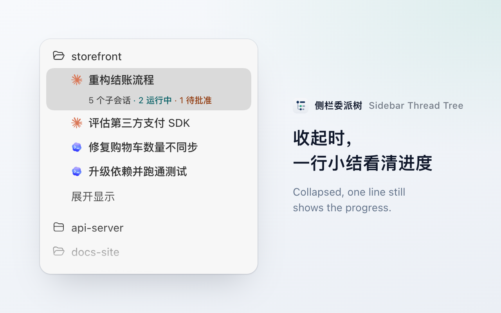
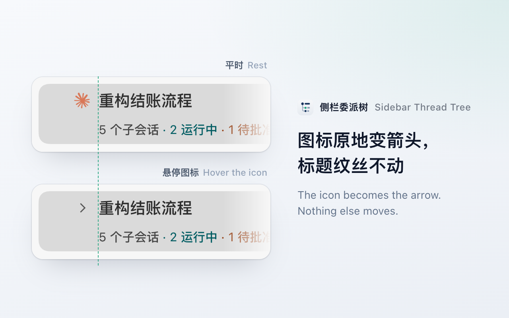
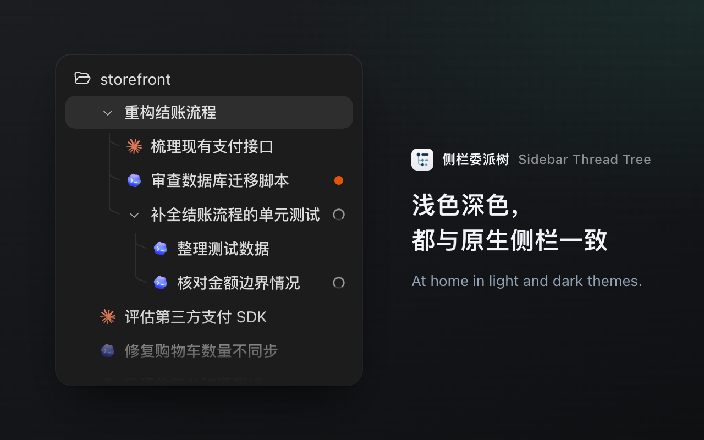

<p align="center"></p>

<h1 align="center">Sidebar Thread Tree</h1>

<p align="center">
  A <a href="https://github.com/BytePioneer-AI/codex-host">codexhost</a> Desktop extension that folds delegated Threads under their parent in the sidebar, with live status at a glance.
</p>

<p align="center"><b>English</b> · <a href="README.zh-CN.md">简体中文</a></p>



Delegate work to other agents and the sidebar stays in order. Each delegated Thread folds under the Thread that started it, so a busy project reads as a few tidy trees instead of one long list. A tree keeps its members together even when the parent sits further down or is not shown.

- **Progress at a glance.** A collapsed parent keeps one summary line, such as "5 child sessions · 2 running · 1 needs approval".
- **Expand in place.** Hover a parent's agent icon and it turns into an arrow. Select it, or the summary line, and nested delegations unfold level by level along rounded guides.
- **Connected across projects.** A child started in another project still hangs under its parent, and its own project shows that parent above it, so you always see where it belongs.
- **See what needs you.** Every child row shows its agent, title and live status, so running work and Threads waiting for you stand out.
- **Works like a native row.** Select any row to open it. Every row, parents and children alike, offers Desktop's own pin, rename and archive from its hover buttons and right-click menu. Opening a Thread expands its parents, and Desktop's next and previous Thread shortcuts follow the tree.
- **Native look and feel.** Rows take their size, fonts and colors from Desktop's sidebar, in light and dark themes. Motion follows Desktop's own curve and is skipped under Reduce Motion.

| Collapsed | Hover | Dark |
| --- | --- | --- |
|  |  |  |

## Install

You need codexhost with Desktop extensions (**Settings → Plugins**), available after 0.22.0.

- **From the marketplace.** Open **Marketplace**, find **Sidebar Thread Tree**, install it and turn it on.
- **From a GitHub link.** Choose **Import plugin → GitHub link** and paste `https://github.com/sduhantao-maker/codexhost-sidebar-thread-tree`.
- **From a local .zip.** Download `sidebar-thread-tree.zip` from the [latest release](https://github.com/sduhantao-maker/codexhost-sidebar-thread-tree/releases/latest), then choose **Import plugin → Local .zip**.

It shares the sidebar badge slot with Sidebar Delegation Badges, so only one of the two can be on at a time.

## How it behaves

- **Never changes a Thread on its own.** Ownership, execution, titles, pinning, archiving and Desktop's order stay with you and Desktop, and rows from remote Hosts are left alone.
- **Leaves Desktop's rows intact.** The extension never moves, wraps or clones Desktop's rows. It lays its toggle over the agent icon, adds its own rows inside the row's list item, and hides rows only through extension marks. Turn it off and the sidebar is exactly as before.
- **Uses Desktop's own actions.** A row the extension draws hands pin, rename and archive to the Thread's own Desktop row, so they behave exactly as on that row. A Thread whose Desktop row is not mounted, for example one beyond **Show more**, offers them once its row is shown.
- **Stays on your machine.** Parent links and live status come from codexhost through the Desktop extension API (`threads.watchTree`, `sidebar.observeRows`). The extension makes no network requests of its own and keeps only which trees are expanded, in this Desktop's local storage.

## Develop

```sh
npm ci
npm run check     # type check, tests and build
npm run package   # dist/sidebar-thread-tree.zip
```

`desktop.js` and `desktop.css` are built from `src/` with the esbuild settings of codexhost's own `tools/build-desktop-extension.mjs`, and committed so codexhost can install straight from the repository. CI checks that they match the source. Before opening a pull request, see [CONTRIBUTING.md](CONTRIBUTING.md).

To release, raise `version` in `manifest.json`, run `npm run package`, and publish a release with the package and every image the manifest names:

```sh
gh release create v0.1.1 dist/sidebar-thread-tree.zip assets/*.png
```

The marketplace installs the `.zip` of the latest release and checks each image against its own release asset.

## Credits

Designed and first built in [codex-host#947](https://github.com/BytePioneer-AI/codex-host/pull/947). The codexhost maintainers adapted it to the Desktop extension platform introduced in [codex-host#992](https://github.com/BytePioneer-AI/codex-host/pull/992). `contracts/shared-contracts.ts` is copied from codexhost.

## License

[LGPL-3.0-only](LICENSE), the same as codexhost.
