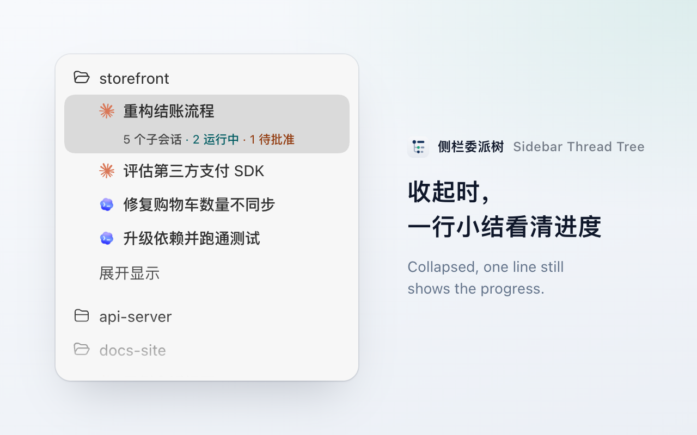
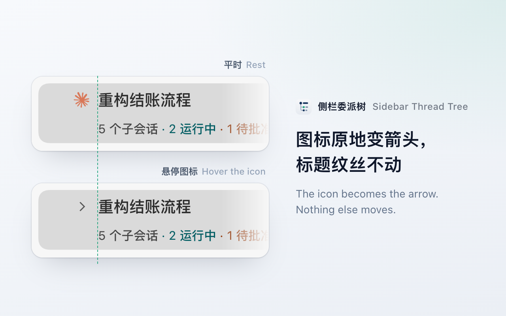
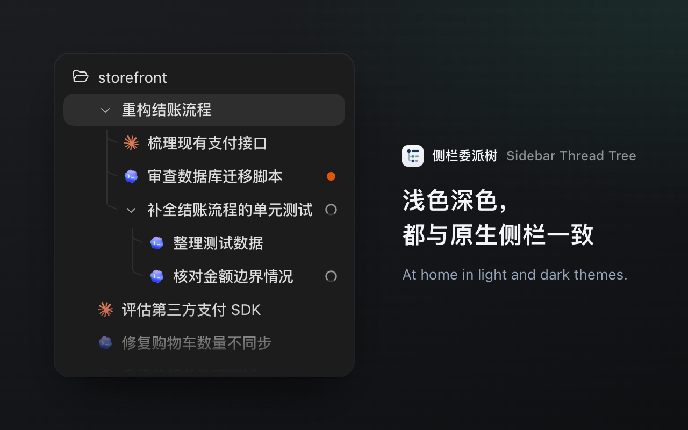

<p align="center"></p>

<h1 align="center">侧栏委派树</h1>

<p align="center">
  <a href="https://github.com/BytePioneer-AI/codex-host">codexhost</a> 的 Desktop 插件。把委派出去的子会话收进父会话下方，进度和待处理一眼可见。
</p>

<p align="center"><a href="README.md">English</a> · <b>简体中文</b></p>


把工作委派给其他 Agent 之后，侧栏依旧井然有序。每个子会话都收在发起它的父会话下方，项目再忙，侧栏也只是几棵层次分明的树。即使父会话排得靠后或没有显示出来，整棵树也会聚在一起，不会散落。

- **不点开也能看进度。** 父会话收起时保留一行小结，例如“5 个子会话 · 2 运行中 · 1 待批准”。
- **原地展开。** 鼠标移到父会话的 Agent 图标上，图标会变成箭头。点击箭头或小结行，多层委派沿圆角连线逐级展开。
- **跨项目也连在一起。** 子会话即使属于另一个项目，也挂在父会话下方；在子会话自己的项目里，也会在它上方显示所属的父会话，隶属关系始终清楚。
- **需要你处理的，一眼就能找到。** 每个子会话都显示 Agent 图标、标题和实时状态，正在运行还是等待处理一目了然。
- **和原生行一样操作。** 点击任意一行即可打开。父会话和子会话都能通过悬停按钮和右键菜单，使用 Desktop 自己的置顶、重命名和归档。打开某个会话时，它的上级会自动展开；切换上一个、下一个会话的快捷键也按树的顺序走。
- **与原生侧栏浑然一体。** 行高、字体和颜色都取自 Desktop 侧栏，浅色深色主题都合适。展开收起的动效沿用 Desktop 自己的曲线，开启“减少动态效果”时不播放。

| 收起 | 悬停 | 深色 |
| --- | --- | --- |
|  |  |  |

## 安装

需要带 Desktop 插件功能（**设置 → 插件**）的 codexhost，0.22.0 之后的版本提供。

- **从插件市场安装。** 打开「市场」，找到「侧栏委派树」，安装后开启。
- **用 GitHub 链接导入。** 点「导入插件 → GitHub 链接」，粘贴 `https://github.com/sduhantao-maker/codexhost-sidebar-thread-tree`。
- **用本地 .zip 包导入。** 从[最新 Release](https://github.com/sduhantao-maker/codexhost-sidebar-thread-tree/releases/latest) 下载 `sidebar-thread-tree.zip`，再点「导入插件 → 本地 .zip 包」。

本插件与「侧栏委派角标」共用侧栏角标槽位，两者同一时间只能启用一个。

## 它怎样工作

- **不会自行改动会话。** 会话的归属、执行、标题、置顶、归档和 Desktop 的排序都由你和 Desktop 决定，远程 Host 的行也不受影响。
- **不动 Desktop 的原生行。** 插件从不移动、包裹或复制 Desktop 的行。展开按钮叠在 Agent 图标上，子会话的行放在该行自己的列表项里，隐藏行只通过插件标记完成。关闭插件后，侧栏立即恢复原样。
- **使用 Desktop 自己的操作。** 插件画出的行会把置顶、重命名和归档交给该会话自己的 Desktop 原生行执行，效果与在原生行上操作完全一样。如果某个会话的原生行还没挂载（比如在「展开显示」之后），等它显示出来后即可使用。
- **数据留在本机。** 父子关系和实时状态由 codexhost 通过 Desktop 插件接口（`threads.watchTree`、`sidebar.observeRows`）提供。插件本身不发起任何网络请求，只在本机 Desktop 的本地存储里记住哪些树是展开的。

## 开发

```sh
npm ci
npm run check     # 类型检查、测试和构建
npm run package   # 生成 dist/sidebar-thread-tree.zip
```

`desktop.js` 和 `desktop.css` 由 `src/` 构建，esbuild 设置与 codexhost 自己的 `tools/build-desktop-extension.mjs` 相同。构建结果提交在仓库里，codexhost 可以直接从仓库安装；CI 会检查它们与源码一致。提交 PR 前请先阅读 [CONTRIBUTING.md](CONTRIBUTING.md#参与贡献)。

发布新版本时，先提高 `manifest.json` 里的 `version`，运行 `npm run package`，再把安装包和 manifest 里列出的每张图片一起发布到 Release：

```sh
gh release create v0.1.1 dist/sidebar-thread-tree.zip assets/*.png
```

插件市场安装最新 Release 里的 `.zip`，并把每张图片与 Release 里同名的附件逐一核对。

## 致谢

本插件的设计和最初实现来自 [codex-host#947](https://github.com/BytePioneer-AI/codex-host/pull/947)，codexhost 维护者把它适配到了 [codex-host#992](https://github.com/BytePioneer-AI/codex-host/pull/992) 引入的 Desktop 插件平台。`contracts/shared-contracts.ts` 摘自 codexhost。

## 许可证

[LGPL-3.0-only](LICENSE)，与 codexhost 相同。
